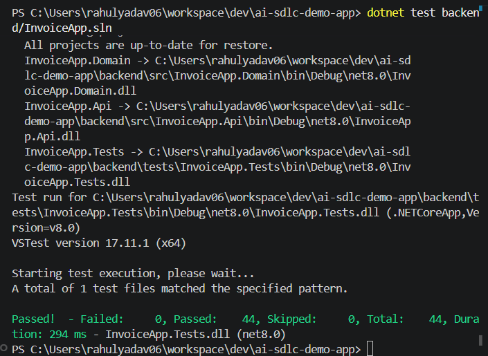
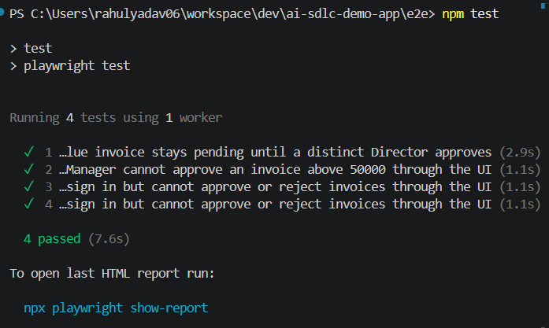
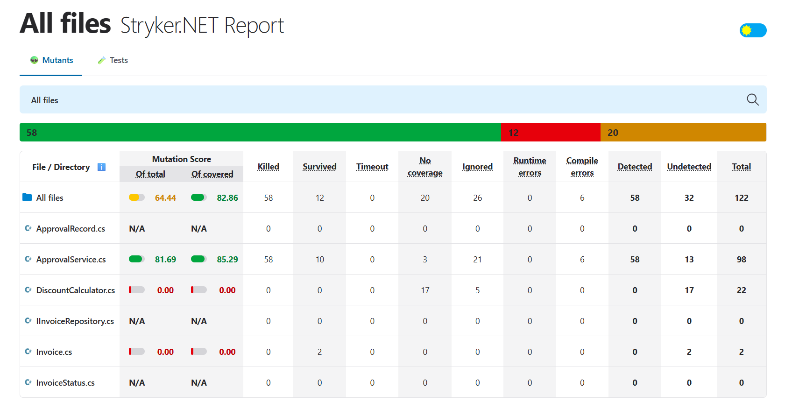
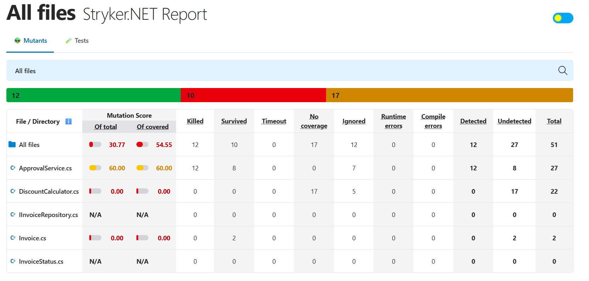

# AI-Assisted Invoice Approval Demo

A small invoice approval application used to demonstrate specification-driven, AI-assisted software development. It models approval limits by role, multi-approver review for high-value invoices, and rejection integrity. The app uses an in-memory repository, so it is intended for local demos and testing—not production use.

> **Repository status:** This README reflects the source and artifacts found in this checkout. `PROJECT_CONTEXT.md` and `HANDOFF.md` are dated snapshots that contain stale branch/status statements. The task checklist also leaves final validation tasks open. See [Evidence and current limitations](#evidence-and-current-limitations) before treating recorded results as current sign-off.

## Table of contents

- [Project overview](#project-overview)
- [Architecture and repository layout](#architecture-and-repository-layout)
- [Business rules](#business-rules)
- [User stories and acceptance coverage](#user-stories-and-acceptance-coverage)
- [Getting started](#getting-started)
- [Testing and quality assurance](#testing-and-quality-assurance)
- [Specification-driven development with Git Spec Kit](#specification-driven-development-with-git-spec-kit)
- [AI-assisted development workflow](#ai-assisted-development-workflow)
- [Agents, skills, and hooks](#agents-skills-and-hooks)
- [Project reference](#project-reference)
- [Demo and evidence](#demo-and-evidence)
- [Evidence and current limitations](#evidence-and-current-limitations)

## Project overview

The business problem is to make invoice decisions according to role-based financial authority while retaining an auditable approval history. The application demonstrates a four-state invoice lifecycle:

`Draft` → `PendingApproval` → `Approved` or `Rejected`

The implementation is a .NET 8 ASP.NET Core Web API with a small static browser UI. It has no database or external identity provider. Demo users and the invoice repository are configured/in-memory for local use.

| Area | Technology |
|---|---|
| Backend and domain | C#, .NET 8, ASP.NET Core Web API |
| UI | Static HTML, CSS, and JavaScript served by the API |
| Data | In-memory repository |
| Backend tests | xUnit and ASP.NET Core TestServer |
| Browser tests | Playwright with TypeScript and Chromium |
| Mutation testing | Global `dotnet-stryker` 4.13.0 installation is present in the inspected environment |
| CI | GitHub Actions, .NET 8 build and test workflow |

## Architecture and repository layout

The solution keeps business decisions in the Domain layer and treats the API and browser as adapters:

```text
backend/
  src/
    InvoiceApp.Domain/   Invoice entities, repository contract, approval lifecycle and rules
    InvoiceApp.Api/      HTTP controllers, demo sign-in, in-memory storage, static UI
  tests/
    InvoiceApp.Tests/    Domain tests and API authorization tests
e2e/
  pages/                 Playwright page objects
  tests/                 Browser end-to-end scenarios
specs/                   Git Spec Kit feature artifacts
.github/
  agents/                Custom read-only/review agents
  hooks/                 Copilot lifecycle logging hook and configuration
  skills/                Reusable AI development workflows
  logs/                  Aggregate and per-session interaction logs
```

| Component | Responsibility |
|---|---|
| `InvoiceApp.Domain` | `ApprovalService` owns invoice transitions and approval/rejection validation. `Invoice`, `ApprovalRecord`, and `InvoiceStatus` represent state and approval history. `IInvoiceRepository` defines the storage boundary. |
| `InvoiceApp.Api` | Controllers parse requests, obtain actor identity from the authenticated session, call Domain services, and map errors to HTTP responses. The API also configures demo users, session auth, the in-memory repository, and the static UI. |
| `InvoiceApp.Tests` | xUnit tests exercise domain rules and controller authorization/state behavior. Tests use `FakeInvoiceRepository`; authorization tests use TestServer. |
| `e2e` | Playwright tests exercise sign-in and invoice workflows through the actual browser UI using page objects and accessible role/label locators. |

## Business rules

The verified runtime behavior is:

1. A Manager may independently approve an invoice up to and including **₹50,000**.
2. A Director may independently approve an invoice up to and including **₹500,000**.
3. An invoice above **₹500,000** is not finalized by a single approval. A first provisional approval is recorded; the invoice remains `PendingApproval`, and final decision metadata remains unset.
4. The implemented high-value flow permits either a Manager or a Director to make that provisional first approval. A **different Director** must provide the second approval.
5. The same username cannot approve twice in the same high-value sequence. The duplicate check is case-insensitive.
6. Only Manager and Director roles can approve or reject. Approver, Admin, and unsupported roles are forbidden at both decision endpoints; the API returns HTTP 403 with `A Manager or Director role is required to perform this operation.`
7. An explicit rejection requires a non-empty reason. It records the authenticated actor, decision time, and reason.
8. Invalid approval attempts return a meaningful domain/API error and are checked before the rejected decision is persisted. Invalid second approvals preserve invoice state and approval history.

### Requirements discrepancy to resolve

The implementation and the US2 task/data-model artifacts explicitly allow a **Manager provisional first approval** above ₹500,000; the ₹50,000 Manager limit applies to an independent single approval in those artifacts. However, `AGENTS.md` states the Manager limit without that qualification, and the specification's FR-002 says a Manager approval above ₹50,000 must be rejected. The specification's US1 Acceptance Scenario 4 also describes a Director attempt above ₹500,000 without a second approver as rejected with the invoice unchanged, while the US2 model records a provisional first approval and changes approval history while keeping the status pending. These requirements should be reconciled by the project owner. This README describes the observed implementation and does not resolve or override the conflicting sources.

See the [full feature specification](specs/001-invoice-approval-limits/spec.md), [implementation plan](specs/001-invoice-approval-limits/plan.md), and [task breakdown](specs/001-invoice-approval-limits/tasks.md) for the detailed requirements and decisions.

## User stories and acceptance coverage

The detailed acceptance scenarios are maintained in the [feature specification](specs/001-invoice-approval-limits/spec.md); this table summarizes the intent and related evidence.

| Story | Objective and important acceptance scenarios | Implementation | Test coverage |
|---|---|---|---|
| **US1 — Manager and Director approval authority** | Enforce role thresholds; accept Manager at ₹50,000 and Director at ₹500,000; reject over-limit or unauthorized single approvals without changing the invoice. The Manager UI over-limit case is also required. | `ApprovalService` threshold validation; `ApprovalsController` role restriction; configured demo users; UI feedback. | [ApprovalServiceTests](backend/tests/InvoiceApp.Tests/ApprovalServiceTests.cs), [authorization tests](backend/tests/InvoiceApp.Tests/ApprovalsControllerAuthorizationTests.cs), [Manager over-limit Playwright test](e2e/tests/manager-over-limit-approval.spec.ts). |
| **US2 — Multi-approver enforcement above ₹500,000** | Require two distinct approvers; keep the invoice pending after the provisional first approval; require the second approver to be a Director; reject duplicate users, wrong second roles, invalid history, and finalized invoices without corrupting state. | `ApprovalService.ApproveHighValueInvoice`; authenticated identity from the API session; approval history on `Invoice`. | Domain tests cover Manager→Director and Director→Director success, duplicate/wrong-role attempts, invalid history, finalized invoices, and concurrency. The [high-value Playwright test](e2e/tests/high-value-two-approver-approval.spec.ts) verifies provisional and final state through the UI. |
| **US3 — Rejection integrity and state preservation** | Require a rejection reason; reject invalid decisions and attempts against finalized invoices; preserve invoice status, metadata, and approval history on failure. Only Manager/Director can decide. | `ApprovalService.Reject` and state guards; role-protected approval endpoints; UI hides decision controls for other roles. | Domain and [API authorization tests](backend/tests/InvoiceApp.Tests/ApprovalsControllerAuthorizationTests.cs) cover rejection, blank reasons, invalid/finalized states, forbidden roles, and unchanged state. [Unsupported-role Playwright tests](e2e/tests/unsupported-roles-cannot-decide.spec.ts) cover the UI. |

## Getting started

### Prerequisites

- .NET 8 SDK
- Node.js and npm for the Playwright suite
- Chromium for Playwright (install with the command below)

### Run the application

From the repository root:

```shell
dotnet run --project backend/src/InvoiceApp.Api
```

The configured HTTP launch profile serves the UI at [http://localhost:5000](http://localhost:5000).

The local demo users in `backend/src/InvoiceApp.Api/appsettings.json` are:

| Username | Password | Role |
|---|---|---|
| `demo.approver` | `ChangeMe123!` | Approver |
| `demo.admin` | `ChangeMe123!` | Admin |
| `demo.manager` | `ChangeMe123!` | Manager |
| `demo.director` | `ChangeMe123!` | Director |

These are demo credentials only. All four accounts may sign in; only Manager and Director may approve or reject invoices. Do not reuse these credentials outside the local demo.

### Build

```shell
dotnet build backend/InvoiceApp.sln --configuration Release
```

### Run backend tests

```shell
dotnet test backend/InvoiceApp.sln
```


### Run Playwright tests

From the repository root:

```shell
cd e2e
npm install
npx playwright install chromium
npm test
```


The Playwright configuration starts the API as a web server, targets Chromium, and writes an HTML report under `e2e/playwright-report/`.

## Testing and quality assurance

### Backend and API tests

`ApprovalServiceTests` covers domain lifecycle and rule behavior with `FakeInvoiceRepository`, including:

- Manager at ₹50,000 and above-limit rejection at ₹50,001.
- Director approvals below the Manager threshold, at ₹50,001, and at ₹500,000.
- Single-approval limit violations and unsupported roles.
- High-value provisional approval, distinct second approver, Director-only second approval, same-user rejection, and invalid approval history.
- Rejected attempts preserving status, history, decision fields, and other invoice data.
- Already-finalized invoice attempts and concurrent high-value first approvals.
- Rejection reason validation and valid rejection behavior.

`ApprovalsControllerAuthorizationTests` uses ASP.NET Core TestServer to check decision endpoint access, session-derived actor identity, HTTP error mapping, and state preservation. The fixture assembles a test host and middleware pipeline; it is not a full test of production `Program.cs` startup wiring.

### Playwright tests

The browser suite uses a page object and accessible locators to verify:

- A Manager's over-limit approval receives a clear reason and leaves the invoice pending without final decision metadata.
- A high-value invoice stays pending with one approval record, then becomes approved only after a distinct Director's approval.
- Approver and Admin can sign in but do not receive approve/reject controls.

### Recorded test evidence

`PROJECT_CONTEXT.md` records that on 2026-11-01 the Release backend suite passed **44 tests**, the API authorization subset passed **17 tests**, and Playwright passed **4 tests**. The local Playwright `last-run` file also records a passed run. These are repository-recorded results, not tests rerun while preparing this README. The context/handoff state is stale in other respects; run the commands above before using those counts as current sign-off.

### Mutation testing

Mutation testing changes production expressions temporarily to check whether tests detect faulty behavior. The inspected environment has global `dotnet-stryker` **4.13.0** installed. No project-specific Stryker config file was found. The locally installed CLI help exposes the `--project`, `--test-project`, and `--mutate` options; see the [US2/final validation task instructions](specs/001-invoice-approval-limits/tasks.md) when selecting the target project.

Example command shape from the repository root (the project/test-project selectors should be confirmed for the local Stryker invocation):

```shell
dotnet-stryker --project backend/src/InvoiceApp.Domain/InvoiceApp.Domain.csproj --test-project backend/tests/InvoiceApp.Tests/InvoiceApp.Tests.csproj
```

Two generated reports are present in this workspace:

- [Stryker report — 2026-11-01 19:10 run](backend/tests/InvoiceApp.Tests/StrykerOutput/2026-11-01.19-10-26/reports/mutation-report.html)

- [Stryker report — 2026-11-01 04:03 run](backend/tests/InvoiceApp.Tests/StrykerOutput/2026-11-01.04-03-37/reports/mutation-report.html)



The reports are local generated artifacts: `StrykerOutput/.gitignore` ignores their contents, so these links will not resolve from a clean GitHub checkout unless the reports are published or otherwise supplied. The project context says mutation testing was not verified, and tasks T054–T058 remain unchecked; this README therefore does not claim a mutation score or final mutation-test sign-off.

## Specification-driven development with Git Spec Kit

Git Spec Kit artifacts were used to turn the assignment into reviewable requirements and ordered implementation work:

**Requirements → Specification → Technical Plan → Task Breakdown → Implementation → Testing → Review**

| Artifact | Purpose |
|---|---|
| [Feature specification](specs/001-invoice-approval-limits/spec.md) | Functional requirements, three user stories, acceptance scenarios, edge cases, constraints, and success criteria. |
| [Implementation plan](specs/001-invoice-approval-limits/plan.md) | Technical context, architecture decisions, story milestones, test strategy, and validation plan. |
| [Task breakdown](specs/001-invoice-approval-limits/tasks.md) | Dependency-ordered setup, foundation, story, and final-validation tasks with human approval checkpoints. |
| [Research and decisions](specs/001-invoice-approval-limits/research.md) | Verified baseline facts, design decisions, and open questions. |
| [Data model](specs/001-invoice-approval-limits/data-model.md) | Invoice/approval entities, transitions, and integrity expectations. |
| [Quickstart](specs/001-invoice-approval-limits/quickstart.md) | Local validation commands and important scenarios. |
| [Approval API contract](specs/001-invoice-approval-limits/contracts/approval-api.md) | Endpoint contracts, authenticated identity handling, and HTTP semantics. |
| [Constitution file](.specify/memory/constitution.md) | Present, but it contains the untouched Spec Kit template placeholders; `plan.md` explicitly says it is not project-specific governance. |

### Phase structure

The specification distinguishes two planning phases:

- **Phase 1 — specification complete:** document current context and requirements, define acceptance criteria and risk cases, and identify architecture constraints and validation needs. The main deliverable is `spec.md`.
- **Phase 2 — implementation planned:** implement the domain rules and role configuration, add API/UI behavior and tests, then run backend, E2E, mutation, and review workflows. The plan and tasks break this into story milestones.

The task file has its own execution phases, which are separate from the specification's planning phases: **Phase 1 Setup**, **Phase 2 Foundational**, **Phase 3 US1**, **Phase 4 US2**, **Phase 5 US3**, and **Phase 6 Final validation and review**. Human review/approval gates and separate story commit milestones are included in that task plan. In the current task file, final-validation items T054–T058 remain unchecked.

## AI-assisted development workflow

The intended workflow combines AI assistance with human review at decision points:

1. **Requirement analysis:** map the assignment and repository conventions to business rules, constraints, and risk cases.
2. **Specification:** use the Spec Kit specification workflow to create user stories, acceptance scenarios, and functional requirements.
3. **Human specification review:** review and approve requirements before broad implementation; preserve unresolved questions rather than silently guessing.
4. **Technical planning and tasks:** record architecture decisions, test strategy, dependencies, and a task sequence.
5. **Implementation assistance:** use AI to implement domain behavior, API adapters, UI feedback, and tests within the documented layer boundaries.
6. **Test generation and execution:** add focused boundary, negative-path, API, and Playwright coverage; run repository test commands.
7. **Mutation testing:** use Stryker to assess whether tests detect altered business logic, and review survivors before sign-off.
8. **AI-assisted review:** use the repository's business-logic, test-quality, PR coordination, and structured review-analysis agents where appropriate.
9. **Human evaluation:** the developer reviews findings, records a reasoned disposition, validates the implementation, and retains authority to accept or reject proposed changes.
10. **Documentation and evidence:** refresh handoff/context documents and retain test, review, and AI interaction evidence.

AI output is assistance—not approval. The developer remains responsible for confirming requirements, reviewing code and test results, deciding review findings, and authorizing commits or releases.

## Agents, skills, and hooks

### Custom agents

| Agent | Responsibility and use | Definition |
|---|---|---|
| `business-logic-reviewer` | Read-only review of story rules, acceptance criteria, business behavior, authorization, boundaries, and state integrity. | [Definition](.github/agents/business-logic-reviewer.agent.md) |
| `review-analysis` | Read-only requirements/implementation analysis producing the repository's 12-section evidence-based report. | [Definition](.github/agents/review-analysis.agent.md) |
| `review-pr` | Coordinates business-logic and test-quality reviews, examines cross-cutting PR concerns, and consolidates a report. | [Definition](.github/agents/review-pr.agent.md) |
| `test-quality-reviewer` | Read-only assessment of unit, API/integration, and E2E coverage and assertion quality. | [Definition](.github/agents/test-quality-reviewer.agent.md) |

### Skills

Skills are reusable instructions or workflows invoked for a task; they are distinct from hooks, which run automatically on lifecycle events.

| Skill | Purpose | Definition |
|---|---|---|
| `ai-interaction-logger` | Describes interaction logging and audit expectations. | [Skill](.github/skills/ai-interaction-logger/SKILL.md) |
| `create-pull-request` | Prepare and create a review-ready PR after explicit authorization. | [Skill](.github/skills/create-pull-request/SKILL.md) |
| `refresh-project-context` | Refresh `PROJECT_CONTEXT.md` and `HANDOFF.md` from verified state. | [Skill](.github/skills/refresh-project-context/SKILL.md) |
| `speckit-analyze` | Non-destructive consistency analysis of spec, plan, and tasks. | [Skill](.github/skills/speckit-analyze/SKILL.md) |
| `speckit-checklist` | Generate a requirements checklist for a feature. | [Skill](.github/skills/speckit-checklist/SKILL.md) |
| `speckit-clarify` | Ask targeted questions to resolve underspecified requirements. | [Skill](.github/skills/speckit-clarify/SKILL.md) |
| `speckit-constitution` | Create or update project principles and governance. | [Skill](.github/skills/speckit-constitution/SKILL.md) |
| `speckit-converge` | Compare implementation with feature artifacts and identify remaining tasks. | [Skill](.github/skills/speckit-converge/SKILL.md) |
| `speckit-implement` | Execute tasks from the feature task breakdown. | [Skill](.github/skills/speckit-implement/SKILL.md) |
| `speckit-plan` | Generate a technical implementation plan from the approved specification. | [Skill](.github/skills/speckit-plan/SKILL.md) |
| `speckit-specify` | Create or update a feature specification from requirements. | [Skill](.github/skills/speckit-specify/SKILL.md) |
| `speckit-tasks` | Generate ordered, dependency-aware implementation tasks. | [Skill](.github/skills/speckit-tasks/SKILL.md) |
| `speckit-taskstoissues` | Deprecated workflow for converting tasks to issues; retained in the repository as a deprecated skill. | [Skill](.github/skills/speckit-taskstoissues/SKILL.md) |

### Copilot hooks and interaction logging

The hook configuration is [`logger.json`](.github/hooks/logger.json); its command handler is [`log-interaction.mjs`](.github/hooks/log-interaction.mjs). It registers the following events:

`SessionStart`, `UserPromptSubmit`, `PreToolUse`, `PostToolUse`, `PostToolUseFailure`, `SubagentStart`, `SubagentStop`, `Stop`, and `SessionEnd`.

For each event, the script writes a timestamped JSON object with the event phase, session ID, and available agent/mode/skill/tool metadata, prompt text, tool arguments, tool result, and error. Events are grouped into per-session `events.jsonl` files. On `Stop` or `SessionEnd`, the script builds an aggregate JSONL summary with prompt, agent/skill/tool metadata, actions, results, and errors in `.github/logs/ai-interactions.jsonl`, then removes that per-session directory. Thus, per-session files are temporary according to the handler, while the aggregate summary is the durable audit stream.

The handler records selected normalized payload fields; despite the skill description mentioning raw hook payloads, the inspected script does not persist the complete raw payload as a separate object. Tool inputs/results may contain sensitive text, so interaction logs should be reviewed and handled as potentially sensitive artifacts. The aggregate log currently present in this checkout is [`.github/logs/ai-interactions.jsonl`](.github/logs/ai-interactions.jsonl).

## Project reference

| File | Purpose |
|---|---|
| [`AGENTS.md`](AGENTS.md) | Project architecture, implementation conventions, approval rules, and validation commands. |
| [`ASSIGNMENT.md`](ASSIGNMENT.md) | Assignment deliverables, workflow expectations, and acceptance requirements. |
| [`PROJECT_CONTEXT.md`](PROJECT_CONTEXT.md) | Dated repository/implementation/validation snapshot; check against current Git state because some status text is stale. |
| [`HANDOFF.md`](HANDOFF.md) | Dated handoff snapshot; its branch/commit status is stale in this checkout. |
| [`ApprovalService.cs`](backend/src/InvoiceApp.Domain/ApprovalService.cs) | Domain lifecycle, approval sequencing, validation, and rejection behavior. |
| [`Invoice.cs`](backend/src/InvoiceApp.Domain/Invoice.cs) | Invoice state, decision fields, and approval history. |
| [`ApprovalRecord.cs`](backend/src/InvoiceApp.Domain/ApprovalRecord.cs) | Approver, role, and approval timestamp record. |
| [`InvoiceStatus.cs`](backend/src/InvoiceApp.Domain/InvoiceStatus.cs) | Invoice lifecycle states. |
| [`IInvoiceRepository.cs`](backend/src/InvoiceApp.Domain/IInvoiceRepository.cs) | Domain repository abstraction and atomic operation contract. |
| [`ApprovalsController.cs`](backend/src/InvoiceApp.Api/Controllers/ApprovalsController.cs) | Approval/rejection endpoints, role restrictions, and authenticated actor propagation. |
| [`InvoicesController.cs`](backend/src/InvoiceApp.Api/Controllers/InvoicesController.cs) | Invoice HTTP operations and submission route. |
| [`Program.cs`](backend/src/InvoiceApp.Api/Program.cs) | Dependency registration and API/static-file middleware setup. |
| [`appsettings.json`](backend/src/InvoiceApp.Api/appsettings.json) | Local demo-user role configuration. |
| [`InvoiceApp.Tests.csproj`](backend/tests/InvoiceApp.Tests/InvoiceApp.Tests.csproj) | xUnit, TestServer, and project references. |
| [`playwright.config.ts`](e2e/playwright.config.ts) | Playwright browser, server, test, and report configuration. |
| [`package.json`](e2e/package.json) | E2E npm scripts and Playwright dependencies. |
| [`CI workflow`](.github/workflows/ci.yml) | GitHub Actions Release build and test commands. |
| [US1 review report](.github/PRs/us1-review-report.md) · [US2 review report](.github/PRs/us2-review-report.md) · [US3 review report](.github/PRs/us3-review-report.md) | Story-specific review evidence and findings. |

## Demo and evidence

- **Demo video:** [Local video file](invoice-approval-ai-sdlc-demo.mp4) is present in this checkout. It is ignored by Git, and no external video URL was found; therefore the relative link will not be available to GitHub readers unless the video is separately published or supplied.
- **Test evidence:** [Project context validation record](PROJECT_CONTEXT.md#verified-validation) records prior backend and Playwright results; [Playwright HTML report](e2e/playwright-report/index.html) and [last-run summary](e2e/test-results/.last-run.json) are local generated artifacts.
- **Mutation evidence:** [Latest local Stryker HTML report](backend/tests/InvoiceApp.Tests/StrykerOutput/2026-11-01.19-10-26/reports/mutation-report.html) and [earlier report](backend/tests/InvoiceApp.Tests/StrykerOutput/2026-11-01.04-03-37/reports/mutation-report.html).
- **Specification/planning:** [spec](specs/001-invoice-approval-limits/spec.md), [plan](specs/001-invoice-approval-limits/plan.md), [tasks](specs/001-invoice-approval-limits/tasks.md), and supporting [research](specs/001-invoice-approval-limits/research.md), [data model](specs/001-invoice-approval-limits/data-model.md), [quickstart](specs/001-invoice-approval-limits/quickstart.md), and [API contract](specs/001-invoice-approval-limits/contracts/approval-api.md).
- **AI usage evidence:** [Aggregate interaction log](.github/logs/ai-interactions.jsonl); per-session event files are generated by the hook and may be temporary.
- **Screenshots:** No project screenshots or image evidence were found in the repository inventory.

## Evidence and current limitations

- The repo uses an in-memory repository and demo-user configuration. Data is not durable, and the app does not demonstrate production identity management or production deployment.
- The US2 Manager provisional-first-approval interpretation and the broader Manager threshold wording need to be reconciled; see [Business rules](#requirements-discrepancy-to-resolve).
- `PROJECT_CONTEXT.md` and `HANDOFF.md` describe an older repository state. Current Git history contains the US3 implementation and documentation commits, while those files still say US3 is uncommitted. Verify status using Git rather than relying solely on those snapshots.
- The task file leaves T054–T058 unchecked. It records the final validation/review checkpoint as pending even though `PROJECT_CONTEXT.md` records backend and Playwright passes.
- Two mutation reports exist in the local workspace, but their output directories are ignored and the context states mutation results were not verified. No mutation score is asserted here; the reports need a human review and a durable evidence location if they are intended for delivery.
- The project contains no standalone `AI_INTERACTION_LOG.md`; the actual aggregate log is the JSONL file linked above. The Spec Kit constitution file remains an unfilled template.
- The demo video and generated test/mutation reports are local ignored artifacts. Supply a stable published link or track/publish the evidence through the project's approved delivery process before relying on GitHub-relative links.
